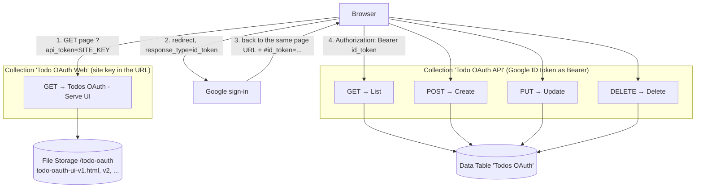

# Workato todo app with Google sign-in (todo-oauth)

A per-user todo list that runs entirely inside Workato, with login through Google. It is a parallel of [`todo-custom`](../todo-custom/README.md) with its own project, data table, recipes, collections and UI. Nothing here is shared with that app.

- **Frontend:** one HTML file in Workato File Storage (`/todo-oauth`)
- **Login:** Google, using the OpenID Connect `id_token` redirect flow (no client secret)
- **API auth:** Workato API Platform validates the Google ID token (OpenID Connect client with custom validation)
- **Data:** a Workato Data Table with an `owner` column. Every read and write is filtered by the signed-in user's email

## Status

| Piece | State |
|---|---|
| Data table, recipes, collections, endpoints, UI in File Storage | Built and running |
| CRUD and owner isolation | Tested with token auth and mock JWTs (list, create, update, delete, 401 with no identity, 404 on another user's row) |
| OpenID Connect client with Google custom validation | **Not set up yet.** GUI step, see [Setup](#setup-in-the-workato-and-google-guis) |
| Google redirect sign-in end to end | **Not tested yet** |

Until the OpenID Connect client exists, the API collection rejects every request, so the page loads but signing in ends in a 401.

## How it works



1. The page is served by a token-protected collection. The site key in the link only gates static HTML, not data.
2. **The page is its own OAuth callback.** Google redirects back to the page URL with `#id_token=...` in the fragment. The page checks `state` and `nonce`, keeps the token in `sessionStorage`, and clears the fragment.
3. Both collections sit on `https://apim.workato.com`, so the browser makes same-origin calls and no CORS setup is needed.
4. Each API recipe gets the caller's email from the trigger's `context.jwt_payload.email`. If that is empty it falls back to decoding the `Authorization` header payload in a Ruby step. The fallback is safe only because the API collection accepts nothing except gateway-verified tokens.
5. Update and delete look the row up first. A row that belongs to someone else returns 404, the same as a missing row.

Google ID tokens last one hour and this flow gives no refresh token, so the page returns to the sign-in screen when the token expires.

## Where everything lives

| Piece | Value |
|---|---|
| Project `Todo App Oauth` | folder `35630008`, project `18138487`, [recipes](https://app.workato.com/recipes?fid=35630008) |
| Data table `Todos OAuth` | id `154249`, UUID `40010fca-ad45-4f49-b38b-42cc686582f6`, [table](https://app.workato.com/data_tables/154249) |
| Collection `Todo OAuth Web` | id `1402133`, slug `todo-oauth-web-v1`, [endpoints](https://app.workato.com/api_groups/1402133/endpoints) |
| Collection `Todo OAuth API` | id `1402134`, slug `todo-oauth-api-v1`, [endpoints](https://app.workato.com/api_groups/1402134/endpoints) |
| Site-key client `Todo OAuth Web Site Key` | client `1282918`, access profile `1370034`, scoped to the Web collection only |
| File Storage folder | `/todo-oauth` ([File Storage](https://app.workato.com/files/management?directory_path=%2Ftodo-oauth)) |
| Google OAuth client ID | `62836436917-2drj9a39hhogs2idvfvmm7ip5tgmggun.apps.googleusercontent.com` |

Recipes: `Todos OAuth - Serve UI` `82702631`, `- List` `82702516`, `- Create` `82702521`, `- Update` `82702629`, `- Delete` `82702628`.

Endpoints: Web `GET` `24022685`. API `GET` `24022689`, `POST` `24022686`, `PUT` `24022687`, `DELETE` `24022688`. Both collections' endpoint paths are the long auto-generated `api_collections/<id>/api_endpoints`. Renaming them is optional (see below).

### Data table columns

`title` (required), `notes`, `completed` (required, boolean), `due_date` (date), `owner` (required, the signed-in user's email, lower-cased).

### URLs

- **Open the app:** `https://apim.workato.com/anz-presales/todo-oauth-web-v1/api_collections/1402133/api_endpoints?api_token=<SITE_KEY>`
- **API base:** `https://apim.workato.com/anz-presales/todo-oauth-api-v1/api_collections/1402134/api_endpoints` (`GET` list, `POST` create, `PUT` update, `DELETE ?id=`)
- Pin a UI version with `&v=v1`. With no `v`, the highest `todo-oauth-ui-vN.html` is served.

The site key is not stored in this repo. It is on access profile `1370034` in API Platform.

## Setup in the Workato and Google GUIs

Done once, by hand:

1. **OpenID Connect client** (Platform > API platform > Clients > Create client)
   - Authentication method: **OpenID Connect**. Discovery URL: `https://accounts.google.com/.well-known/openid-configuration`.
   - Attach the **Todo OAuth API** collection only.
   - Open the client's **Applications**, create an application with credential type **Custom validation**. Issuer: `https://accounts.google.com`. Claim rules: `aud` one of the Google client ID above, `sub` exists, `email` exists.
2. **Google Cloud Console** (APIs & Services > Credentials > the `Todo OAuth` Web application client)
   - Authorized JavaScript origin: `https://apim.workato.com`.
   - Authorized redirect URI: the exact page URL from [URLs](#urls), including `?api_token=<SITE_KEY>` and no fragment. It must match character for character.
3. Open the app link, sign in, add a todo.

Optional: rename the collection slugs to `todo-oauth-web` and `todo-oauth-api`, and the endpoint paths to `ui` and `todos` (only editable in the GUI). If you do, update `API_URL` at the top of the HTML, publish it as a new version, and register the new page URL in Google.

## Publish a new UI version

1. Copy the newest `todo-oauth-ui-vN.html` to `todo-oauth-ui-v{N+1}.html` and edit it. Config sits at the top of the script: `GOOGLE_CLIENT_ID` and `API_URL`.
2. Add it to `/todo-oauth` in File Storage, either by uploading in the GUI or with a temporary recipe using `workato_files` `store_file` (`file_path` `/todo-oauth`).
3. **`store_file` never overwrites.** Publishing a file whose name already exists fails with "File already exists". Use a new version number, or delete the old file in the GUI first.
4. Reload the link. The highest version is served automatically. To roll back, pin an older one with `&v=vN`.

`todo-oauth-ui-v1.html` and `todo-oauth-ui-v2.html` are copies of what is in File Storage. They differ only in the signed-out headline.

## Verify

Once the OpenID Connect client is set up, get an ID token by signing in, then:

```sh
API="https://apim.workato.com/anz-presales/todo-oauth-api-v1/api_collections/1402134/api_endpoints"
ID_TOKEN="<paste from sessionStorage id_token>"

curl -s -H "Authorization: Bearer $ID_TOKEN" "$API"          # {"records_json":"[...]"}
curl -s "$API"                                                # 401
```

## Quirks worth knowing

- **Endpoint paths.** The dev API derives an endpoint's path from the route it was created on, so the paths are the long `api_collections/...` form. Slugs and paths are only editable in the GUI.
- **Trigger context.** API recipe triggers expose `context.headers.<Name>` and `context.jwt_payload.<claim>`. Request headers must be declared in the trigger's `request.headers` schema to appear.
- **Recipes returning several statuses** declare each response in the trigger (`200`, `401`, `404`) and use `if` blocks with complementary conditions, because API-triggered recipes reject `else`.
- **`completed` comes back as the string `"true"` or `"false"`** from create and update. The UI normalises it.
- **The list is fetched whole and filtered by owner inside a Ruby step.** That is fine for a demo and does not scale to large tables.
- **A Ruby step can use `Base64` and `JSON` without `require`.**
